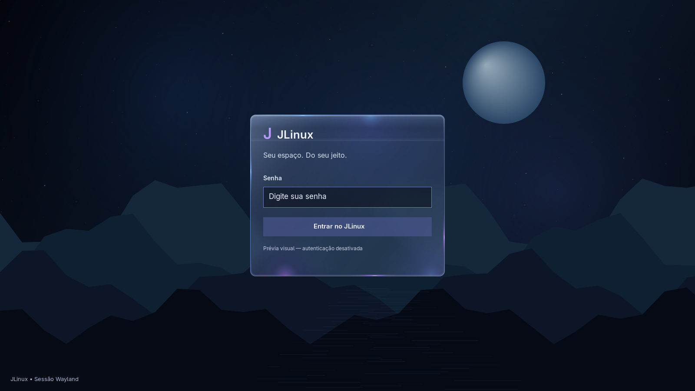
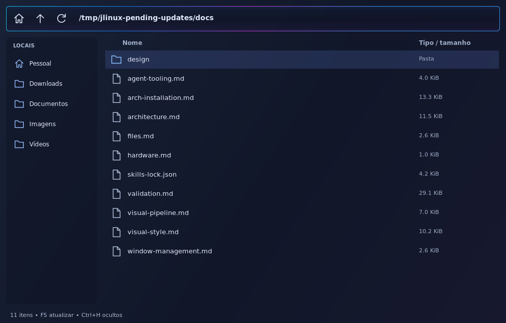
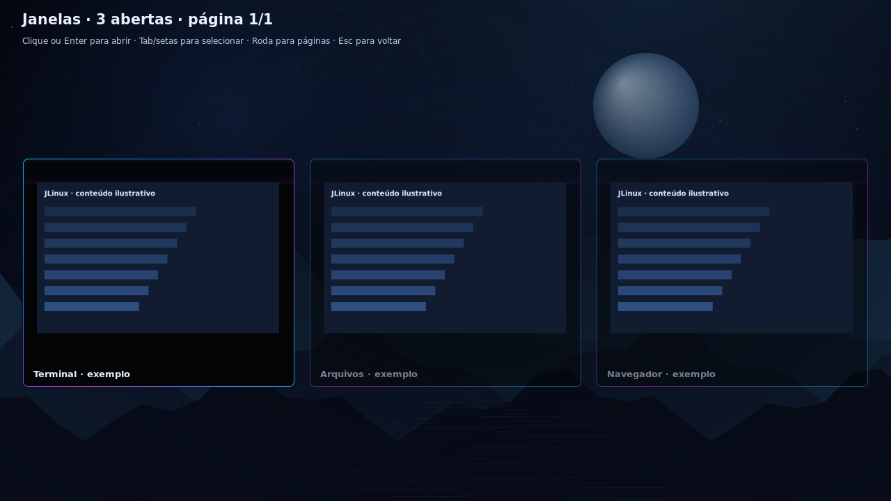

# Referência mais recente — Futurista

[Imagem do usuário](futurista-reference.png) · [Dock](futurista-dock-only.png) · [Painel](futurista-control-only.png) · [Implementação e limites](../futurista.md). A nova tela substitui as referências anteriores para barra, dock circular e centro de controle. Correspondência exata ainda não foi alcançada; instalação da prévia completa autorizada pelo usuário.

# JLinux — referências visuais escolhidas pelo usuário

**Direção atual:** o usuário pediu a remoção completa do dock lateral. As fotos originais abaixo são preservadas como referência de material e cores, mas a presença do dock nelas está superada. A prévia nativa atualizada não contém o componente.

As duas imagens do commit **cf4238a — “Estilo que eu quero”**, enviado pelo usuário em feature/glass-design-preview, são a referência principal para reproduzir o visual das próximas telas. O pedido é seguir essas fotos fielmente, sem reinterpretar o estilo a partir das propostas geradas anteriormente.

## Referência 1 — desktop, dock e aplicativo

[Abrir referência 1 no celular](1E9E8B07-9F84-40EA-B5AA-73308C2A7A66.png?raw=true).

## Referência 2 — janelas sobrepostas e componentes

[Abrir referência 2 no celular](D415668D-8698-411F-A41D-0DE333BCE255.png?raw=true).

## Elementos a reproduzir

- Material escuro azul-preto, translúcido, com profundidade; evitar vidro cinza/prateado dominante ou superfícies inteiramente roxas.
- Bordas finas iluminadas, reflexos azuis/violetas localizados e curvas suaves, conforme as fotos.
- Dock estreito à esquerda, com ícones coloridos e a composição da primeira referência.
- Barra superior e espaçamentos da primeira referência: identidade JLinux, menus à esquerda, data/hora ao centro e informações/energia à direita.
- Janelas amplas com cantos arredondados, cabeçalhos e controles compactos; painéis internos e divisórias conforme os exemplos.
- Paisagem noturna espacial com lago/montanhas, luz azul e vegetação/reflexos rosas, como fundo mostrado nas imagens.
- Tipografia, proporções e hierarquia visual das referências, mantendo leitura nítida.

As imagens são o alvo visual; não comprovam que navegador, música, conectividade ou efeitos já estejam implementados. Elas não contêm assets separados nem especificações de medidas. Na reprodução, comparar o resultado renderizado com as referências na mesma resolução e registrar diferenças, em vez de declarar fidelidade sem inspeção.

O próximo protótipo deve seguir essas referências diretamente. A implementação definitiva permanece nativa e mantém animation/, effects/ e renderer/ separados, com controle individual de efeitos e desempenho medido.

## Histórico substituído

A imagem gerada jlinux-glass-v1.png foi preservada como histórico. As propostas V1 e V2 não são a direção visual escolhida; as referências acima têm precedência.

## Primeira base nativa — estado de implementação

## Material inicial do shell nativo

Produzida por `jlinux-shell --preview`, usando as rotinas do shell, sem janelas de aplicativos. O painel amostra o wallpaper procedural provisório com blur em cache e reflexos estáticos. Não é captura da sessão, não reproduz o fundo das fotos nem demonstra blur sobre janelas. As referências escolhidas acima continuam sendo o alvo.

## Moldura nativa de janela

Gerada por `jlinux-test-window-frame --preview`: usa os quatro buffers reais de decoração sobre um fundo e conteúdo ilustrativo. Não é captura de aplicativo. Cabeçalho de 36 px, bordas, transparência e fechar são código do compositor. Não demonstra blur de outras janelas nem personalização do interior dos aplicativos.

## Tela de login nativa

Imagem gerada por `jlinux-greeter --preview`, usando o toolkit C do projeto. Material Glass escuro, bordas finas e brilhos localizados. A imagem é do modo de prévia e não demonstra autenticação PAM real.

## Gerenciador de arquivos inicial

Gerada por `jlinux-files --preview`: barra Glass compartilhada e lista opaca. Não é captura da sessão, não demonstra blur do conteúdo nem operações de gerenciamento além das descritas em ../files.md.

### Iteração de neon discreto

As prévias nativas de moldura e Arquivos acima foram atualizadas: sem pontos focais nas janelas, contorno contínuo azul/violeta e fundo azul-ardósia no cliente. São desenhos dos componentes, não capturas de sessão nem prova de fidelidade exata às fotos. A barra conserva seu acabamento anterior.

## Prévia consolidada dos pedidos atuais

As prévias de shell, moldura e Arquivos agora combinam barra reta com fade, cabeçalho preto e bordas com toque rosado, sem dock e sem menus à esquerda. São desenhos nativos dos componentes, não capturas da sessão instalada. A geometria atual segue os pedidos posteriores às fotos. Inventário da consolidação em [applied-updates.md](../applied-updates.md).

## Visão de janelas

Gerada pelo teste de renderer com conteúdo ilustrativo e blur desativado. Mostra grade, títulos e seleção Glass; não é captura de aplicativos reais ou do pipeline de captura/desfoque. Esse pipeline foi testado separadamente em headless/Pixman e GLES2.

## Dock funcional e configurações nativas

[Dock com ícones instalados e bordas neon](futurista-dock-only.png) · [Configurações por categoria](futurista-settings.png). Prévias Cairo de 12/11/2026; não são capturas da sessão física. Implementação, estados ilustrativos, catálogo e limites em docs/futurista.md.

## Degradê do dock a partir do print

[Referência gerada corrigida](dock-gradient-reference-v2.png) · [Renderização nativa](dock-gradient-native.png) · [Comparação amostrada](dock-gradient-comparison.json). O print de origem é uma captura física, preservada apenas no diretório privado de Imagens do usuário; as imagens públicas removem as janelas externas ao dock. Fonte, geração, método e diferenças em docs/futurista.md. Comparação na mesma resolução não demonstrou igualdade pixel a pixel.
