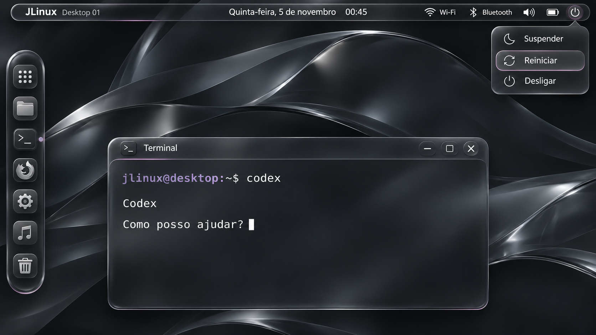

# JLinux Glass — propostas visuais

**Imagens conceituais para avaliação.** Geradas como referências visuais; não são capturas da sessão atual nem comprovam implementação dos componentes ou efeitos.

## V2 — escuro e discreto (proposta atual)

[Abrir V2 para ampliar no celular](jlinux-glass-v2.png?raw=true).

Ajuste solicitado: roxo/rosa não são as cores principais. Predominam grafite, carvão, vidro fumê e reflexos prateados, com cor apenas em detalhes de algumas bordas e indicadores. A proposta mantém o aspecto futurista detalhado, o dock à esquerda e a barra superior com Wi-Fi, Bluetooth e menu de energia.

## V1 — referência anterior

[Abrir V1 para comparar](jlinux-glass-v1.png?raw=true).

O feedback do usuário sobre a V1 foi reduzir a predominância de roxo/rosa e tornar a paleta mais escura e discreta. A V1 foi preservada como histórico, não como direção atual.

## Elementos mantidos

- Dock vertical de aplicativos **à esquerda**.
- Barra superior com Wi-Fi, Bluetooth, informações de estado e botão de energia.
- Menu com Suspender, Reiniciar e Desligar.
- Material inspirado em Glass, com terminal ilustrativo.

A V2 ainda aguarda avaliação. Não assumir aprovação nem aplicar o visual ao desktop antes da iteração com o usuário. As ações de energia e conectividade são ilustradas apenas. A implementação nativa continuará separando animation/, effects/ e renderer/, com controles individuais e medição de desempenho.
