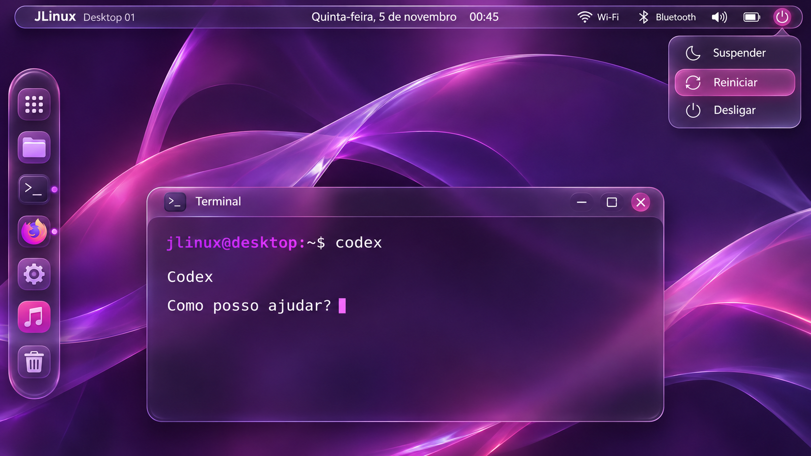

# JLinux Glass — proposta visual V1

**Imagem conceitual para avaliação.** Gerada como referência visual; não é captura da sessão atual e não comprova implementação dos componentes ou efeitos.

[Abrir a imagem](jlinux-glass-v1.png?raw=true) para ampliar no navegador do celular. Não precisa de visualizador instalado no computador.

## Direção solicitada

- Dock vertical de aplicativos **à esquerda**.
- Barra superior com Wi-Fi, Bluetooth, informações de estado e botão de energia.
- Menu de energia com Suspender, Reiniciar e Desligar.
- Visual inspirado em Glass, com bastante detalhe em roxo/rosa.
- Terminal ilustrativo para mostrar o material aplicado a uma janela.

O usuário ainda avaliará a composição. Cores, intensidade de brilho, transparência, dock, ícones e proporções podem ser ajustados na próxima versão antes da implementação nativa. Não assumir aprovação desta imagem.

As ações de energia e conectividade são ilustradas apenas. Sua implementação dependerá de integração real com os serviços do sistema. Os efeitos nativos continuam separados entre animation/, effects/ e renderer/, com controles individuais e medição de desempenho.
