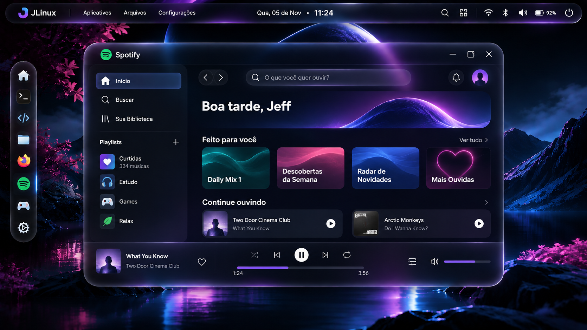
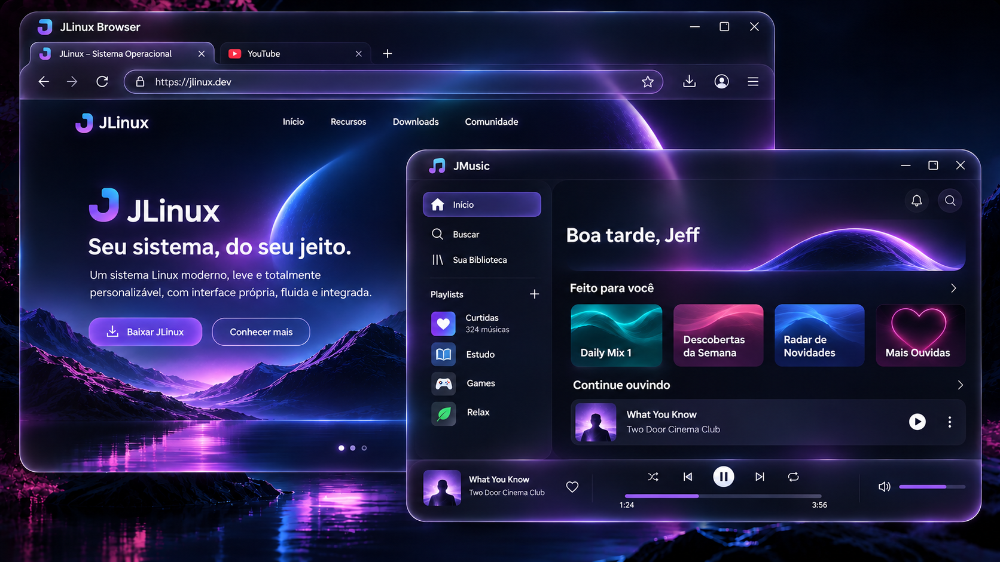
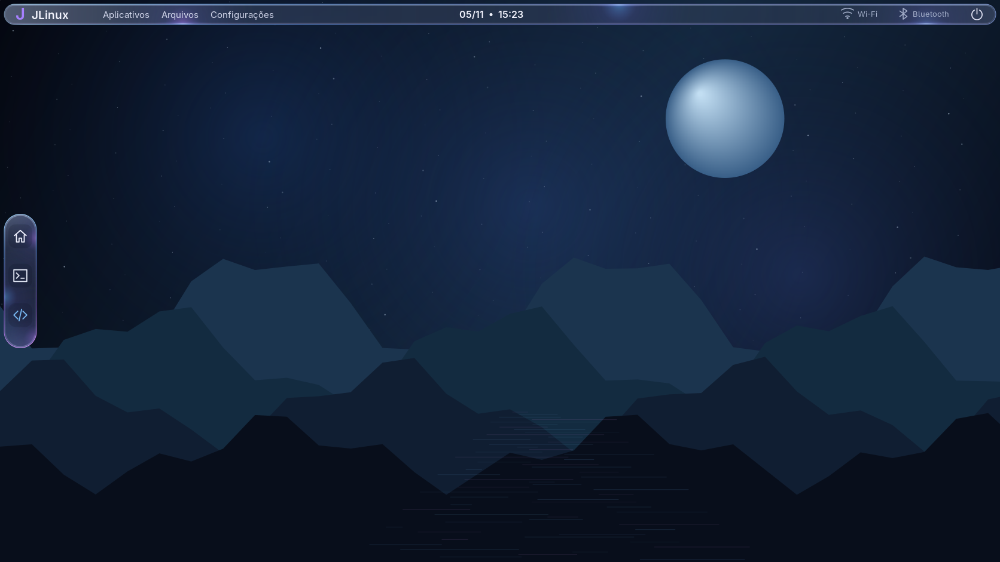
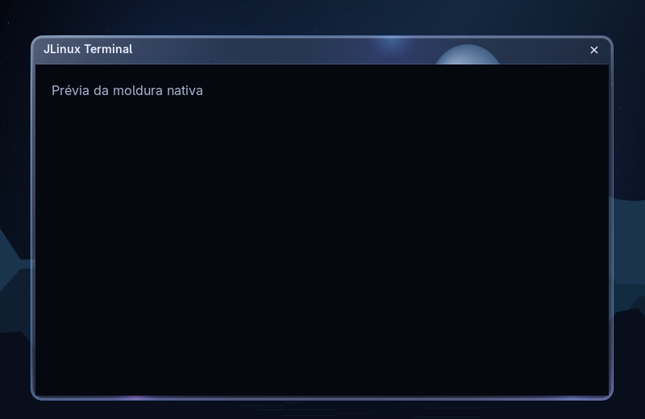

# JLinux — referências visuais escolhidas pelo usuário

As duas imagens do commit **cf4238a — “Estilo que eu quero”**, enviado pelo usuário em feature/glass-design-preview, são a referência principal para reproduzir o visual das próximas telas. O pedido é seguir essas fotos fielmente, sem reinterpretar o estilo a partir das propostas geradas anteriormente.

## Referência 1 — desktop, dock e aplicativo

[Abrir referência 1 no celular](1E9E8B07-9F84-40EA-B5AA-73308C2A7A66.png?raw=true).

## Referência 2 — janelas sobrepostas e componentes

[Abrir referência 2 no celular](D415668D-8698-411F-A41D-0DE333BCE255.png?raw=true).

## Elementos a reproduzir

- Material escuro azul-preto, translúcido, com profundidade; evitar vidro cinza/prateado dominante ou superfícies inteiramente roxas.
- Bordas finas iluminadas, reflexos azuis/violetas localizados e curvas suaves, conforme as fotos.
- Dock estreito à esquerda, com ícones coloridos e a composição da primeira referência.
- Barra superior e espaçamentos da primeira referência: identidade JLinux, menus à esquerda, data/hora ao centro e informações/energia à direita.
- Janelas amplas com cantos arredondados, cabeçalhos e controles compactos; painéis internos e divisórias conforme os exemplos.
- Paisagem noturna espacial com lago/montanhas, luz azul e vegetação/reflexos rosas, como fundo mostrado nas imagens.
- Tipografia, proporções e hierarquia visual das referências, mantendo leitura nítida.

As imagens são o alvo visual; não comprovam que navegador, música, conectividade ou efeitos já estejam implementados. Elas não contêm assets separados nem especificações de medidas. Na reprodução, comparar o resultado renderizado com as referências na mesma resolução e registrar diferenças, em vez de declarar fidelidade sem inspeção.

O próximo protótipo deve seguir essas referências diretamente. A implementação definitiva permanece nativa e mantém animation/, effects/ e renderer/ separados, com controle individual de efeitos e desempenho medido.

## Histórico substituído

A imagem gerada jlinux-glass-v1.png foi preservada como histórico. As propostas V1 e V2 não são a direção visual escolhida; as referências acima têm precedência.

## Primeira base nativa — estado de implementação

[Desenho inicial do shell C](native-shell-baseline.png): PNG produzido pelas próprias rotinas Cairo/Pango do toolkit, no modo `jlinux-shell --preview`. Não é uma nova referência escolhida, uma imagem gerada por IA ou uma captura da sessão real. Mostra apenas os componentes já desenhados: painel e dock de três ações. Wallpaper, materiais Glass, ícones completos e fidelidade às fotos acima continuam em implementação.

## Material inicial do shell nativo

Produzida por `jlinux-shell --preview`, usando as rotinas do shell, sem janelas de aplicativos. Painel/dock amostram o wallpaper procedural provisório com blur em cache e reflexos estáticos. Não é captura da sessão, não reproduz o fundo das fotos nem demonstra blur sobre janelas. As referências escolhidas acima continuam sendo o alvo.

## Moldura nativa de janela

Gerada por `jlinux-test-window-frame --preview`: usa os quatro buffers reais de decoração sobre um fundo e conteúdo ilustrativo. Não é captura de aplicativo. Cabeçalho de 36 px, bordas, transparência e fechar são código do compositor. Não demonstra blur de outras janelas nem personalização do interior dos aplicativos.
